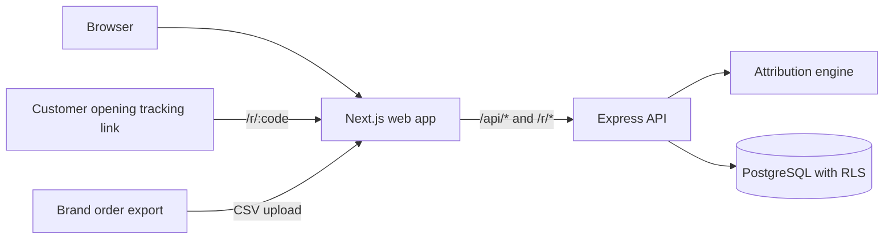

<div align="center">

# SalesTrace Ethiopia

### Creator campaign attribution and analytics for Ethiopian businesses

Connect creator links, coupon codes and QR referrals to imported orders. Give marketing teams a clear, auditable view of attributed campaign and creator performance.

</div>

> **Attribution is association, not causation.** SalesTrace reports attributed revenue and ROAS. It does not measure incremental sales or profit.

## Contents

- [Product overview](#product-overview)
- [Features](#features)
- [Technology stack](#technology-stack)
- [Architecture](#architecture)
- [Repository structure](#repository-structure)
- [Getting started](#getting-started)
- [Environment configuration](#environment-configuration)
- [Database and demo data](#database-and-demo-data)
- [Testing and quality](#testing-and-quality)
- [Attribution principles](#attribution-principles)
- [Deployment](#deployment)
- [Contributing](#contributing)
- [Documentation](#documentation)
- [License](#license)

## Product overview

SalesTrace is a B2B campaign measurement application for Ethiopian brands and the marketing teams, campaign managers and analysts who work with creators. It addresses a practical reporting gap: creator activity often happens on social platforms, while order records live elsewhere.

A business assigns creators to campaigns and gives each creator trackable links or coupon codes. SalesTrace records link visits and QR referrals, accepts order exports through CSV, and applies documented rules to eligible clicks and order signals. Teams can then review attributed orders, revenue, costs and ROAS by campaign or creator.

## Features

The capabilities below are implemented in the current repository and covered by application code and tests; see [MVP scope](docs/mvp-scope.md) for deferred work.

| Area                             | Current capability                                                                                                                                                                                        |
| -------------------------------- | --------------------------------------------------------------------------------------------------------------------------------------------------------------------------------------------------------- |
| Authentication and organizations | Registration, verification and password reset flows; organization onboarding, membership, invitations, sessions and role-based access. Local auth supports development; Supabase Auth is also integrated. |
| Campaigns and creators           | Campaign lifecycle and budgets, creator profiles and social accounts, campaign assignments, agreed fees and typed campaign costs.                                                                         |
| Tracking                         | Creator-specific links, coupon codes, QR generation, referral event capture, click de-duplication and tracking redirects.                                                                                 |
| Order imports                    | CSV upload, column mapping, validation preview, duplicate handling, transactional import and downloadable row errors.                                                                                     |
| Attribution                      | Versioned, deterministic attribution using eligible clicks, coupons and imported referral identifiers, with recorded conflict decisions.                                                                  |
| Analytics and reporting          | Organization overview, campaign and creator performance, time series, filters and CSV exports.                                                                                                            |
| Governance                       | Organization-scoped authorization, PostgreSQL Row Level Security, audit events, request IDs, rate limits and structured logs.                                                                             |

Native ecommerce connectors, creator payouts, a discovery marketplace, mobile apps and incremental lift measurement are deferred or out of scope. See [MVP scope](docs/mvp-scope.md) for the supported roadmap and non-goals.

## Technology stack

| Purpose         | Technologies                                                                                                         |
| --------------- | -------------------------------------------------------------------------------------------------------------------- |
| Web frontend    | Next.js 15 App Router, React 19, TypeScript, Tailwind CSS                                                            |
| API             | Node.js, Express 4, TypeScript, Zod, Pino                                                                            |
| Database        | PostgreSQL, versioned SQL migrations, Row Level Security; Supabase is supported                                      |
| Authentication  | Local scrypt-based provider for development and CI; Supabase Auth provider                                           |
| Shared packages | TypeScript workspace packages for shared types, validation and attribution calculations                              |
| Testing         | Vitest, PGlite for API integration tests, Playwright for browser E2E tests                                           |
| Tooling         | pnpm workspaces, ESLint, Prettier, TypeScript                                                                        |
| CI              | GitHub Actions workflow for linting, type checks, tests and builds; a separate job runs E2E tests against PostgreSQL |

## Architecture

The web app serves the browser and forwards `/api/*` and `/r/*` requests to the Express API. The API validates and authorizes requests, applies business rules, calls the framework-independent attribution package when needed, and stores organization-scoped data in PostgreSQL.



The diagram reflects the configured web proxy and API modules. Supabase Auth is used when `AUTH_MODE=supabase`; local authentication is available for development and CI.

## Repository structure

```text
SalesTrace-Ethiopia/
├── apps/
│   ├── api/                    # Express API, database access and API tests
│   └── web/                    # Next.js app, components and browser tests
├── packages/
│   ├── attribution-engine/     # Pure attribution and metric calculations
│   ├── shared-types/           # Shared DTOs, enums and money/time helpers
│   └── validation/             # Shared Zod schemas
├── supabase/
│   ├── migrations/             # Ordered, versioned database migrations
│   └── seed.sql                # Optional demo data
├── docs/                       # Product, architecture, API and operations docs
├── .github/workflows/ci.yml    # Continuous integration workflow
├── .env.example                # API and database environment reference
└── pnpm-workspace.yaml
```

## Getting started

### Prerequisites

- Node.js 20.11 or later
- pnpm 9 (the repository specifies pnpm 9.12.0)
- PostgreSQL 15 or later, locally or through a Supabase project

### Install and configure

Clone the repository, enter its root directory, and install dependencies:

```bash
git clone <repository-url>
cd SalesTrace-Ethiopia
pnpm install
```

Create the API environment file from the example and set the required values:

```bash
cp .env.example .env
```

Set `DATABASE_URL` to a PostgreSQL database and `IP_HASH_PEPPER` to a private value of at least 8 characters. The example defaults to `AUTH_MODE=local` for development. Never commit `.env` or put real credentials in documentation.

The web app reads its settings from `apps/web/.env.example`. For the defaults shown there, it forwards requests to the API at `http://localhost:4000` and serves the app at `http://localhost:3000`. Copy it to `apps/web/.env.local` only if you need to override those defaults.

### Migrate and start

From the repository root:

```bash
pnpm build
pnpm db:migrate
pnpm db:seed       # optional demo data
```

Start the API and web app in separate terminals:

```bash
pnpm dev:api
```

```bash
pnpm dev:web
```

Visit [http://localhost:3000](http://localhost:3000). The API listens on port `4000` by default. In local auth mode, new accounts are verified automatically; no mail service is needed for this development flow.

### Common setup issues

- **API reports missing configuration:** confirm `.env` is at the repository root and includes `DATABASE_URL` and an `IP_HASH_PEPPER` of at least 8 characters.
- **Database connection fails:** verify PostgreSQL is running, the database exists, and `DATABASE_URL` is correct. Hosted databases may require TLS; configure `DATABASE_SSL` as appropriate. Production always requires TLS.
- **Supabase auth fails to start:** set `SUPABASE_URL`, `SUPABASE_ANON_KEY` and `SUPABASE_SERVICE_ROLE_KEY` when `AUTH_MODE=supabase`.
- **Web app cannot reach the API:** verify the API is running and `API_INTERNAL_URL` in the web environment points to it.

## Environment configuration

The root [`.env.example`](.env.example) documents API and database settings. The web settings are in [`apps/web/.env.example`](apps/web/.env.example).

| Variable                                                         | Purpose                                                                                           |
| ---------------------------------------------------------------- | ------------------------------------------------------------------------------------------------- |
| `DATABASE_URL`                                                   | PostgreSQL connection string; required by the API and migration runner.                           |
| `IP_HASH_PEPPER`                                                 | Private salt used to hash visitor IP addresses; minimum 8 characters.                             |
| `AUTH_MODE`                                                      | `local` for development/CI or `supabase` for Supabase Auth. Local auth is rejected in production. |
| `SUPABASE_URL`, `SUPABASE_ANON_KEY`, `SUPABASE_SERVICE_ROLE_KEY` | Required when using Supabase Auth. Keep the service role key server-side.                         |
| `PUBLIC_BASE_URL`                                                | Public web origin used to construct tracking links.                                               |
| `COOKIE_SECURE`                                                  | Must be `true` in production.                                                                     |
| `DATABASE_SSL`                                                   | Enables TLS for PostgreSQL; production requires a TLS database connection.                        |
| `API_INTERNAL_URL`                                               | Server-side destination for the web app's API and tracking proxy.                                 |
| `NEXT_PUBLIC_APP_URL`                                            | Public application URL used by the web app.                                                       |

The API validates configuration at startup and reports variable names and format requirements without printing values.

## Database and demo data

Migrations in `supabase/migrations` are applied in order and are the source of truth for the schema. Applied migration files are checksum-verified; make schema changes in a new migration.

```bash
pnpm db:migrate
```

Load the optional demo organization, creators, campaigns, tracking assets and costs with:

```bash
pnpm db:seed
```

The seed command refuses to run in production.

## Testing and quality

| Command                                  | What it checks                                                                            |
| ---------------------------------------- | ----------------------------------------------------------------------------------------- |
| `pnpm test`                              | Runs tests across workspace packages.                                                     |
| `pnpm test:engine`                       | Attribution policy and financial metric calculations.                                     |
| `pnpm test:api`                          | API unit and integration tests, including database behavior using PGlite.                 |
| `pnpm test:web`                          | Web component and utility tests.                                                          |
| `pnpm --filter @salestrace/web test:e2e` | Playwright browser journeys; requires a running app/API and migrated PostgreSQL database. |
| `pnpm typecheck`                         | Type-checks workspace packages.                                                           |
| `pnpm lint`                              | Runs ESLint.                                                                              |
| `pnpm build`                             | Builds shared packages, API and web app.                                                  |

The CI workflow also builds the apps and runs E2E tests using a PostgreSQL service. For local E2E runs, start the database, run migrations, then start the API and web app before running the Playwright command.

## Attribution principles

- The default attribution window is seven days and can be configured per campaign. Window boundaries and eligible-click conditions are explicit in the [attribution policy](docs/attribution-rules.md).
- Eligible clicks use last-click selection. Coupon signals take precedence over conflicting link signals, and the decision and rule version are recorded.
- CSV order imports validate rows, identify duplicates and preserve imported values. Re-import reconciliation is supported.
- Pending and cancelled orders do not count as valid sales. Refunds reduce net attributed revenue; cancellations remain visible but contribute zero revenue.
- **Attributed revenue is not profit or incremental revenue.** ROAS is attributed net revenue divided by campaign cost; it does not establish causation or profitability.

See [financial metrics](docs/financial-metrics.md) for definitions and [attribution rules](docs/attribution-rules.md) for edge cases.

## Deployment

The repository contains a CI workflow and production configuration checks, but no deployment manifests or environment-specific release configuration. Deployment is therefore provider-specific. A production deployment needs a Node.js host for the API, a host capable of running the Next.js app, and a PostgreSQL database; configure production secrets, Supabase Auth if selected, secure cookies, TLS and allowed CORS origins for those environments.

The API exposes liveness and readiness endpoints at `/api/v1/health` and `/api/v1/health/ready`. The [architecture guide](docs/architecture.md) and [security guide](docs/security-and-tenancy.md) describe the application design and security controls.

## Contributing

There is no separate contribution guide yet. To prepare a change, create a focused branch, keep changes within the relevant app or shared package, and update documentation when behavior changes. Before opening a pull request, run the relevant tests plus:

```bash
pnpm typecheck
pnpm lint
pnpm build
```

For changes to attribution or financial calculations, update the corresponding policy documentation and tests as well.

## Documentation

- [Product requirements](docs/product-requirements.md)
- [MVP scope and deferred features](docs/mvp-scope.md)
- [Architecture and decisions](docs/architecture.md)
- [Database schema](docs/database-schema.md)
- [Attribution rules](docs/attribution-rules.md)
- [Financial metric definitions](docs/financial-metrics.md)
- [API specification](docs/api-specification.md)
- [Security and tenancy](docs/security-and-tenancy.md)
- [Threat model](docs/threat-model.md)
- [Testing strategy](docs/testing-strategy.md)
- [Implementation plan](docs/implementation-plan.md)
- [Assumptions and decisions](docs/assumptions.md)

## License

No license has been selected yet. All rights are reserved by default; reuse and redistribution permissions have not been granted. Add a `LICENSE` file once the project owner chooses a license.
