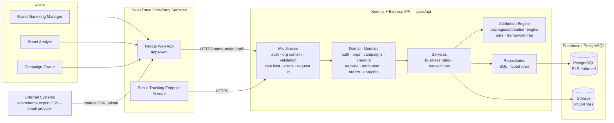
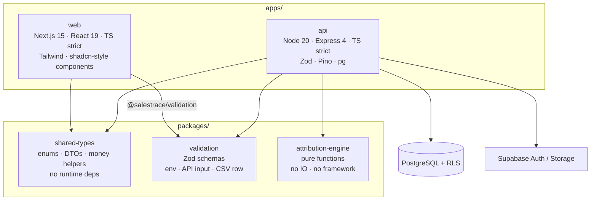
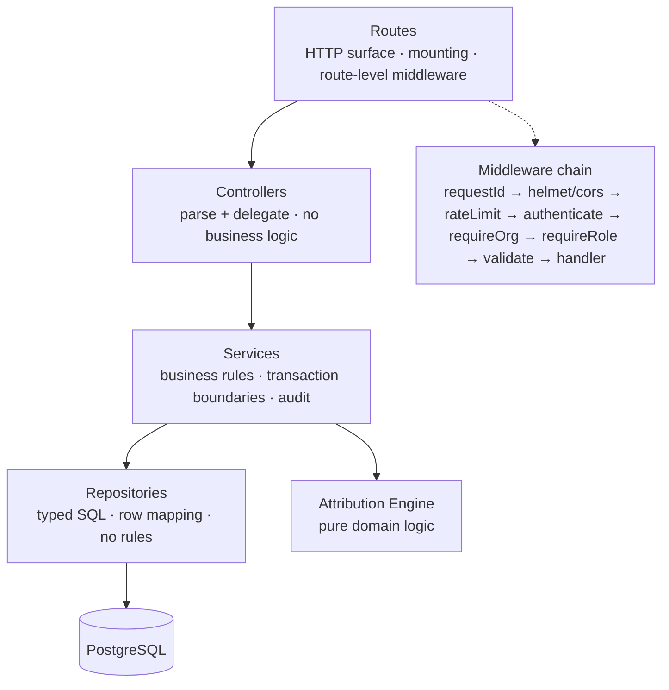
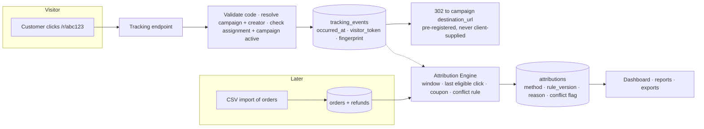

# Architecture Proposal — SalesTrace Ethiopia

## 1. Architectural drivers

| Driver | Architectural implication |
|---|---|
| Multi-tenant B2B SaaS, hard isolation | Isolation must be *structural* (database-enforced), not a convention in application code. |
| Money correctness | Integer minor units; a single calculation layer; no duplicated formulas anywhere. |
| Auditable business rules | Attribution must be pure, versioned, and replayable; every decision stores its rule snapshot. |
| Fast iteration in a small team | Modular monolith, not microservices. Clear package boundaries instead of network boundaries. |
| Uncertain integrations | External platforms behind interfaces, with CSV as the first-class ingestion path. |
| Regulatory caution (Ethiopian personal data context) | Minimize customer data: pseudonymize customer references, hash IPs, hash emails for fingerprints. |

## 2. System context



## 3. Container view (monorepo)



**Dependency rule (enforced):** arrows point from dependent to dependency only.
`attribution-engine` depends on `shared-types` and nothing else — no Express, no `pg`, no Zod.
`validation` depends on `shared-types`. `shared-types` depends on nothing.

## 4. Backend layering



Rules of the layering, enforced by review and by the absence of `pg` imports outside repositories:

1. **Routes** may not import repositories directly.
2. **Controllers** may not contain conditional business rules; they translate HTTP to service calls.
3. **Services** own business rules and transaction boundaries. A service may call other services.
4. **Repositories** own SQL. A repository never decides *policy*; it receives the policy as parameters.
5. **Attribution engine** owns the attribution decision. Services persist its output; they never re-implement it.

## 5. Request lifecycle

```mermaid
sequenceDiagram
  autonumber
  participant C as Client (browser)
  participant NX as Next.js (proxy)
  participant MW as Express middleware
  participant S as Service
  participant DB as PostgreSQL

  C->>NX: POST /api/v1/campaigns  (httpOnly session cookie)
  NX->>MW: forward /api/*  (same origin)
  MW->>MW: requestId → helmet → cors → rate limit
  MW->>MW: verify session → load org membership + role
  MW->>MW: validate body (Zod)
  MW->>S: createCampaign(ctx, input)
  S->>DB: BEGIN; SET LOCAL ROLE salestrace_app;
  S->>DB: SET LOCAL app.current_org_id = :orgId
  S->>DB: INSERT campaigns ... (RLS checks org match)
  S->>DB: INSERT audit_events ...
  S->>DB: COMMIT
  MW-->>C: 201 { data, meta: { requestId } }
```

### Tenant isolation in the request path

Isolation is applied at three independent layers. Any one of them failing is a defect; all three
must hold simultaneously:

1. **Service layer** — every repository call receives `ctx.organizationId` and includes it in the
   `WHERE` clause.
2. **Database RLS** — every organization-owned table carries
   `USING (organization_id = app.current_org_id())`. The API connects as `salestrace_app`
   (`NOBYPASSRLS`); within each transaction it sets `app.current_org_id`. If the application
   forgets the org filter, RLS still hides other tenants' rows. If the org context is missing,
   `current_setting('app.current_org_id', true)` is NULL and **no rows match** (fail closed).
3. **Route/middleware layer** — the org is derived from the *session*, never from a request body
   or query parameter. A `campaignId` in a path is always re-validated for membership in the
   session's organization before any read or write.

## 6. Authentication architecture

```mermaid
flowchart LR
  subgraph Browser
    F[Web App<br/>fetch same-origin /api/*]
  end
  subgraph API
    A1[POST /auth/login] --> A2[AuthProvider]
    A2 --> A3[Set-Cookie: st_session (HttpOnly, SameSite=Lax, Secure in prod)]
  end
  F --> A1
  F -->|Cookie sent automatically| A3
  A3 --> A4[SessionMiddleware → ctx.user, ctx.organization, ctx.role]
```

- **Supabase Auth** is the production identity provider (`AUTH_MODE=supabase`): the API verifies the
  bearer token against Supabase's `getUser`, and provisions the local `profiles` row on first use.
- **Local identity provider** (`AUTH_MODE=local`): scrypt password hashing plus HS256 session
  tokens issued by the API. This exists so the full system — including E2E tests — runs and is
  verifiable without a Supabase project. It is a real implementation behind the same interface,
  selected by configuration; it is never enabled in production.
- **Session transport**: `httpOnly` cookie. The Next.js app proxies `/api/*` to the API so the
  browser only ever talks to one origin — this keeps `SameSite=Lax` viable and avoids
  cross-site token exposure. Mutation endpoints additionally validate `Origin`/`Referer`
  (CSRF defence).
- **Authorization** is always re-checked server-side per request; the client only uses roles to
  hide UI affordances.

## 7. Data flow: click to attributed order



## 8. Key technology decisions (ADR summary)

| # | Decision | Rationale | Alternatives rejected |
|---|---|---|---|
| A1 | Modular monolith, pnpm workspaces | One team, one deployable unit for API; boundaries enforced by packages | Microservices (operational cost, no benefit at this scale) |
| A2 | Express 4 + TypeScript strict | Team familiarity, mature middleware ecosystem | Fastify (marginally faster; no material benefit here) |
| A3 | `pg` driver behind a `DbDriver` port | Real transactions, `SET LOCAL ROLE` for RLS, no vendor lock-in | Supabase JS client only (weak transaction + RLS-context control) |
| A4 | PGlite for integration tests | Real PostgreSQL semantics in-process; no Docker needed in CI or on laptops | Dockerized Postgres (not available in all environments); `pg-mem` (not faithful enough for RLS) |
| A5 | Integer minor units (`BIGINT`) for money | Exact arithmetic, no float drift; matches Ethiopian cent practice | `NUMERIC` (works, but string/decimal handling in JS is awkward); floats (rejected outright) |
| A6 | CSV first, integrations later | CSV removes the dependency on an unvalidated platform decision | Building Shopify/Woo integrations first (premature) |
| A7 | Rule snapshots stored with each attribution | Replayable, auditable, explains historical numbers after policy changes | Recompute-only (loses history) |
| A8 | Next.js proxies `/api/*` and `/r/*` to the API | Same-origin cookies, first-party tracking URLs, no CORS complexity for the browser | Direct cross-origin API calls (cookie/cookie-policy friction, CORS surface) |
| A9 | Hand-written shadcn-style components | shadcn/ui components are copied into the repo by design; avoids CLI/network coupling and keeps the dependency set minimal | shadcn CLI init (adds generated churn) |
| A10 | `Origin`/`Referer` validation for mutations | Adequate CSRF defence for a cookie session, same-origin architecture | Double-submit CSRF token (more moving parts; revisit if embedding changes) |

Full ADR log with consequences: `docs/architecture.md#11-adr-log`.

## 9. Deployment topology

| Component | Target | Notes |
|---|---|---|
| `apps/web` | Vercel | Next.js; env `NEXT_PUBLIC_API_BASE_URL` for the proxy target, `API_INTERNAL_URL` server-side |
| `apps/api` | Node host (Fly.io / Render / Railway / ECS) | Long-running Express process; `PORT`, `DATABASE_URL`, `AUTH_*`, `SUPABASE_*` |
| PostgreSQL | Supabase | Managed; migrations applied by `pnpm db:migrate` in a release step |
| Storage | Supabase Storage bucket `salestrace-imports` | Private; access only through backend-issued signed URLs |
| CI | GitHub Actions | typecheck → lint → unit → integration → build → E2E |

### Environment strategy

`development`, `test`, `production` are separated by environment variables only, with two
non-negotiable rules:

- `NODE_ENV=production` refuses to start if `AUTH_MODE=local` or if the database URL is not TLS.
- Missing or malformed configuration fails fast at boot with a single, readable error message
  (never a partially working process).

## 10. Scalability posture (MVP-realistic)

| Concern | MVP approach | Scaling path |
|---|---|---|
| Request volume | Single API instance; stateless except DB pool | Horizontal scaling is safe: session state is in Postgres, no in-memory session store |
| Order import volume | Streaming CSV parse, batched inserts inside one transaction | Partition import jobs; move to a queue worker when import time becomes user-visible |
| Reporting volume | Pre-aggregated SQL views with indexed filters | Materialized views or an incremental rollup table once campaigns reach 10⁵ orders |
| Tracking events | Indexed by `(organization_id, occurred_at)` | Time-based partitioning once daily events exceed ~10⁶ |

## 11. ADR log

| Date | ADR | Status |
|---|---|---|
| 2026-10-21 | A1–A10 above | Accepted |
| 2026-10-21 | Money stored as `BIGINT` minor units with an explicit `currency` column; no FX | Accepted |
| 2026-10-21 | Attribution engine is a pure package with no I/O; services persist its decisions | Accepted |
| 2026-10-21 | Audit trail is append-only at the application level (revoke UPDATE/DELETE + trigger). Explicitly **not** claimed to be tamper-proof | Accepted |

## 12. Known limitations (documented, not hidden)

1. **Attribution is not causation.** The platform measures association under a declared rule.
2. **Local identity provider** exists for offline/E2E verification; production must use Supabase Auth.
3. **No platform integrations yet.** Orders arrive by CSV; data freshness depends on the customer's export process.
4. **Tracking relies on links/coupons.** Where a brand sells offline and a customer never clicks a link,
   attribution depends on coupon codes or manual referral identifiers in the order data.
5. **No incremental measurement.** ROAS is not ROI and is not an incrementality estimate.
