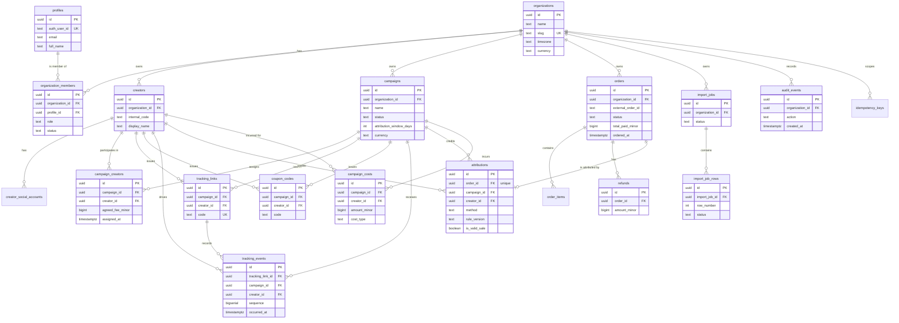

# Database Schema — SalesTrace Ethiopia

**Engine:** PostgreSQL (Supabase) · **Source of truth:** `supabase/migrations/*.sql`
**Money:** `BIGINT` minor units · **Time:** `TIMESTAMPTZ` (UTC) · **IDs:** `UUID` (v4)

> Every change to the schema is a numbered migration. Application code never issues DDL.

---

## 1. Entity relationship diagram



---

## 2. Isolation model

Three layers, all required simultaneously:

1. **Application:** every query filters by `organization_id` taken from the session context, never
   from user input.
2. **Row Level Security:** every organization-owned table has

   ```sql
   USING (organization_id = app.current_org_id())
   ```

   `app.current_org_id()` is a `STABLE` SQL function reading
   `current_setting('app.current_org_id', true)::uuid`. When the setting is absent it returns
   `NULL` → the predicate is `NULL` → **no rows are visible**. Fail-closed by construction.
3. **Database role:** the API runs as `salestrace_app` (`NOBYPASSRLS`). Migrations and seeding run
   as `postgres`. The API issues `SET LOCAL ROLE salestrace_app` inside every transaction, so even
   a `postgres`-owned connection is constrained by RLS for application traffic.

`audit_events` additionally has `REVOKE UPDATE, DELETE` for `salestrace_app` and a trigger that
raises on any UPDATE/DELETE — the trail is append-only *at the application level*. This is not a
claim of tamper-proofing.

---

## 3. Tables

### 3.1 `profiles`

Global (not org-scoped) mirror of an authenticated user.

| Column | Type | Null | Default | Notes |
|---|---|---|---|---|
| `id` | uuid | no | `gen_random_uuid()` | PK, internal user id |
| `auth_user_id` | text | no | — | Supabase Auth uid, or local auth id |
| `email` | text | no | — | lower-cased |
| `full_name` | text | yes | — | |
| `avatar_url` | text | yes | — | |
| `created_at` | timestamptz | no | `now()` | |
| `updated_at` | timestamptz | no | `now()` | |

Unique: `auth_user_id`. Index: `email`.

### 3.2 `organizations`

| Column | Type | Null | Default | Notes |
|---|---|---|---|---|
| `id` | uuid | no | `gen_random_uuid()` | PK |
| `name` | text | no | — | 2–120 chars |
| `slug` | text | no | — | unique, `[a-z0-9-]` |
| `timezone` | text | no | `'Africa/Addis_Ababa'` | IANA name, display conversion |
| `currency` | text | no | `'ETB'` | ISO-4217, reporting currency |
| `settings` | jsonb | no | `'{}'` | e.g. `{ "trackingBaseUrl": "..." }` |
| `created_at` / `updated_at` | timestamptz | no | `now()` | |

### 3.3 `organization_members`

| Column | Type | Null | Default | Notes |
|---|---|---|---|---|
| `id` | uuid | no | `gen_random_uuid()` | PK |
| `organization_id` | uuid | no | — | FK → organizations (cascade) |
| `profile_id` | uuid | no | — | FK → profiles |
| `role` | text | no | `'analyst'` | `owner` \| `admin` \| `marketer` \| `analyst` |
| `status` | text | no | `'active'` | `active` \| `invited` \| `suspended` |
| `invited_email` | text | yes | — | for pending invitations |
| `invitation_token` | text | yes | — | unique, hashed at rest |
| `invited_by` | uuid | yes | — | FK → profiles |
| `created_at` / `updated_at` | timestamptz | no | `now()` | |

Unique: `(organization_id, profile_id)`. Index: `(profile_id)`, `(organization_id, status)`.
Check: role and status enumerations.

### 3.4 `creators`

| Column | Type | Null | Default | Notes |
|---|---|---|---|---|
| `id` | uuid | no | `gen_random_uuid()` | PK |
| `organization_id` | uuid | no | — | FK → organizations |
| `internal_code` | text | no | — | human key, unique per org |
| `display_name` | text | no | — | |
| `contact_email` | text | yes | — | |
| `contact_phone` | text | yes | — | |
| `platform` | text | yes | — | e.g. `instagram`, `tiktok`, `youtube` |
| `niche` | text | yes | — | free-text category |
| `profile_url` | text | yes | — | optional public URL |
| `audience_location` | text | yes | — | free text, manually entered |
| `audience_language` | text | yes | — | e.g. `am`, `om` |
| `notes` | text | yes | — | |
| `status` | text | no | `'active'` | `active` \| `inactive` |
| `created_at` / `updated_at` | timestamptz | no | `now()` | |

Unique: `(organization_id, internal_code)`. Index: `(organization_id, display_name)`.
> No follower counts, engagement rates, or audience demographics are stored: they would be
> unverifiable. Anything not manually entered or obtained from a verified integration is absent.

### 3.5 `creator_social_accounts`

| Column | Type | Null | Default | Notes |
|---|---|---|---|---|
| `id` | uuid | no | `gen_random_uuid()` | PK |
| `organization_id` | uuid | no | — | FK → organizations |
| `creator_id` | uuid | no | — | FK → creators (cascade) |
| `platform` | text | no | — | |
| `handle` | text | no | — | |
| `url` | text | yes | — | |
| `is_primary` | boolean | no | `false` | |
| `verified` | boolean | no | `false` | false = manually entered |
| `created_at` / `updated_at` | timestamptz | no | `now()` | |

Unique: `(creator_id, platform, handle)`.

### 3.6 `campaigns`

| Column | Type | Null | Default | Notes |
|---|---|---|---|---|
| `id` | uuid | no | `gen_random_uuid()` | PK |
| `organization_id` | uuid | no | — | FK → organizations |
| `name` | text | no | — | 2–160 chars |
| `objective` | text | yes | — | free text |
| `description` | text | yes | — | |
| `status` | text | no | `'draft'` | `draft`\|`active`\|`paused`\|`completed`\|`archived` |
| `start_at` | timestamptz | no | — | |
| `end_at` | timestamptz | yes | — | must be > start_at |
| `budget_minor` | bigint | yes | — | ≥ 0 |
| `currency` | text | no | `'ETB'` | must equal org currency |
| `attribution_window_days` | int | no | `7` | 1–90 |
| `attribution_policy_version` | text | no | `'v1.0.0'` | rule version recorded on attributions |
| `destination_url` | text | no | — | pre-registered redirect target (https only) |
| `created_by` | uuid | yes | — | FK → profiles |
| `archived_at` | timestamptz | yes | — | set when archived |
| `created_at` / `updated_at` | timestamptz | no | `now()` | |

Checks: `status` enum, `budget_minor >= 0`, `attribution_window_days between 1 and 90`,
`end_at > start_at`, `destination_url ~ '^https://'`.
Index: `(organization_id, status)`, `(organization_id, start_at)`.

### 3.7 `campaign_creators`

| Column | Type | Null | Default | Notes |
|---|---|---|---|---|
| `id` | uuid | no | `gen_random_uuid()` | PK |
| `organization_id` | uuid | no | — | FK → organizations |
| `campaign_id` | uuid | no | — | FK → campaigns (cascade) |
| `creator_id` | uuid | no | — | FK → creators (cascade) |
| `agreed_fee_minor` | bigint | yes | — | ≥ 0, in campaign currency |
| `currency` | text | no | `'ETB'` | must equal campaign currency |
| `assigned_at` | timestamptz | no | `now()` | editable/back-datable; click eligibility lower bound |
| `status` | text | no | `'active'` | `active` \| `removed` |
| `notes` | text | yes | — | |
| `created_at` / `updated_at` | timestamptz | no | `now()` | |

Unique: `(campaign_id, creator_id)`. Index: `(organization_id, creator_id)`.

### 3.8 `tracking_links`

| Column | Type | Null | Default | Notes |
|---|---|---|---|---|
| `id` | uuid | no | `gen_random_uuid()` | PK |
| `organization_id` | uuid | no | — | FK → organizations |
| `campaign_id` | uuid | no | — | FK → campaigns (cascade) |
| `creator_id` | uuid | no | — | FK → creators |
| `code` | text | no | — | public opaque code, Crockford base32, 10 chars |
| `channel` | text | no | `'link'` | `link` \| `qr` |
| `label` | text | yes | — | |
| `destination_url` | text | no | — | override of campaign destination; https only |
| `is_active` | boolean | no | `true` | |
| `created_at` / `updated_at` | timestamptz | no | `now()` | |

Unique: `(organization_id, code)`; also `code` globally unique (public route lookup).
Index: `(organization_id, campaign_id)`, `(organization_id, creator_id)`.

### 3.9 `coupon_codes`

| Column | Type | Null | Default | Notes |
|---|---|---|---|---|
| `id` | uuid | no | `gen_random_uuid()` | PK |
| `organization_id` | uuid | no | — | FK → organizations |
| `campaign_id` | uuid | no | — | FK → campaigns (cascade) |
| `creator_id` | uuid | no | — | FK → creators |
| `code` | text | no | — | normalised to upper case |
| `discount_type` | text | no | — | `percentage` \| `fixed` |
| `discount_value_minor` | bigint | no | — | ≥ 0 (percent value 0–100 stored separately) |
| `discount_percent` | numeric(5,2) | yes | — | for `percentage` type |
| `max_redemptions` | int | yes | — | |
| `redemption_count` | int | no | `0` | |
| `valid_from` | timestamptz | yes | — | |
| `valid_until` | timestamptz | yes | — | |
| `is_active` | boolean | no | `true` | |
| `created_at` / `updated_at` | timestamptz | no | `now()` | |

Unique: `(organization_id, code)`. Index: `(organization_id, campaign_id)`.
> A coupon with no creator would not be a creator signal; `creator_id` is therefore NOT NULL by
> design in the MVP (site-wide coupons are out of scope).

### 3.10 `tracking_events`

| Column | Type | Null | Default | Notes |
|---|---|---|---|---|
| `id` | uuid | no | `gen_random_uuid()` | PK |
| `organization_id` | uuid | no | — | FK → organizations |
| `tracking_link_id` | uuid | no | — | FK → tracking_links |
| `campaign_id` | uuid | no | — | FK → campaigns |
| `creator_id` | uuid | no | — | FK → creators |
| `event_type` | text | no | `'click'` | `click` |
| `occurred_at` | timestamptz | no | `now()` | event time (UTC) |
| `sequence` | bigserial | no | — | monotonic tie-break for click ordering |
| `visitor_token` | text | yes | — | random per-visitor id (first-party cookie) |
| `fingerprint` | text | yes | — | sha256(ip+ua) — never raw IP |
| `repeat_count` | int | no | `1` | coalesced repeat hits |
| `ip_hash` | text | yes | — | sha256 with server pepper |
| `user_agent` | text | yes | — | truncated to 512 chars |
| `referrer` | text | yes | — | truncated to 1024 chars |
| `created_at` | timestamptz | no | `now()` | |

Index: `(organization_id, occurred_at)`, `(campaign_id, occurred_at)`, `(creator_id, occurred_at)`,
`(tracking_link_id, occurred_at)`.
De-duplication: a repeat hit for the same `(tracking_link_id, fingerprint)` within 30 s increments
`repeat_count` instead of inserting a row.

### 3.11 `orders`

| Column | Type | Null | Default | Notes |
|---|---|---|---|---|
| `id` | uuid | no | `gen_random_uuid()` | PK |
| `organization_id` | uuid | no | — | FK → organizations |
| `external_order_id` | text | no | — | id in the source system |
| `source` | text | no | `'csv'` | `csv` \| `api` \| `manual` |
| `ordered_at` | timestamptz | no | — | UTC |
| `currency` | text | no | `'ETB'` | |
| `subtotal_minor` | bigint | no | `0` | |
| `discount_minor` | bigint | no | `0` | |
| `tax_minor` | bigint | no | `0` | |
| `shipping_minor` | bigint | no | `0` | |
| `total_paid_minor` | bigint | no | `0` | amount collected |
| `status` | text | no | `'pending'` | `pending`\|`paid`\|`cancelled`\|`partially_refunded`\|`refunded` |
| `coupon_code` | text | yes | — | as provided (normalised copy stored) |
| `referral_identifier` | text | yes | — | tracking code or coupon code from source |
| `customer_ref_hash` | text | yes | — | sha256 of customer reference — no raw customer data |
| `source_import_id` | uuid | yes | — | FK → import_jobs |
| `created_at` / `updated_at` | timestamptz | no | `now()` | |

Unique: `(organization_id, external_order_id)` — **the duplicate-order guard**.
Index: `(organization_id, ordered_at)`, `(organization_id, status)`, `(organization_id, coupon_code)`.
Checks: all amounts `>= 0`, `status` enum, `currency` matches `^[A-Z]{3}$`.

### 3.12 `order_items`

| Column | Type | Null | Default | Notes |
|---|---|---|---|---|
| `id` | uuid | no | `gen_random_uuid()` | PK |
| `organization_id` | uuid | no | — | FK → organizations |
| `order_id` | uuid | no | — | FK → orders (cascade) |
| `sku` | text | yes | — | |
| `name` | text | yes | — | |
| `quantity` | int | no | `1` | > 0 |
| `unit_price_minor` | bigint | no | `0` | |
| `line_total_minor` | bigint | no | `0` | |
| `created_at` | timestamptz | no | `now()` | |

Index: `(order_id)`. Items are optional; the MVP imports item rows only when the CSV provides them.

### 3.13 `refunds`

Append-only refund records.

| Column | Type | Null | Default | Notes |
|---|---|---|---|---|
| `id` | uuid | no | `gen_random_uuid()` | PK |
| `organization_id` | uuid | no | — | FK → organizations |
| `order_id` | uuid | no | — | FK → orders (cascade) |
| `amount_minor` | bigint | no | — | > 0 |
| `currency` | text | no | `'ETB'` | |
| `reason` | text | yes | — | |
| `external_refund_id` | text | yes | — | id in source system |
| `refunded_at` | timestamptz | no | — | |
| `source_import_id` | uuid | yes | — | FK → import_jobs |
| `created_at` | timestamptz | no | `now()` | |

Unique: `(order_id, external_refund_id)` (partial, where `external_refund_id is not null`).
Index: `(order_id)`, `(organization_id, refunded_at)`.

### 3.14 `attributions`

| Column | Type | Null | Default | Notes |
|---|---|---|---|---|
| `id` | uuid | no | `gen_random_uuid()` | PK |
| `organization_id` | uuid | no | — | FK → organizations |
| `order_id` | uuid | no | — | FK → orders (cascade) — **UNIQUE** |
| `campaign_id` | uuid | no | — | FK → campaigns |
| `creator_id` | uuid | no | — | FK → creators |
| `method` | text | no | — | `link`\|`qr_link`\|`coupon_code`\|`referral_identifier` |
| `rule_version` | text | no | — | e.g. `v1.0.0` |
| `rule_snapshot` | jsonb | no | `'{}'` | resolved policy used for this decision |
| `decision_reason` | text | no | — | enumerated reason code |
| `conflict_flag` | boolean | no | `false` | |
| `conflict_detail` | jsonb | yes | — | losing candidate(s) + evidence |
| `matched_event_id` | uuid | yes | — | FK → tracking_events |
| `matched_coupon_id` | uuid | yes | — | FK → coupon_codes |
| `is_valid_sale` | boolean | no | `false` | derived from order status |
| `attributed_at` | timestamptz | no | `now()` | |
| `created_at` / `updated_at` | timestamptz | no | `now()` | |

Unique: `order_id` — guarantees an order is counted once.
Index: `(organization_id, campaign_id)`, `(organization_id, creator_id)`,
`(organization_id, conflict_flag)`, `(organization_id, method)`.

### 3.15 `campaign_costs`

| Column | Type | Null | Default | Notes |
|---|---|---|---|---|
| `id` | uuid | no | `gen_random_uuid()` | PK |
| `organization_id` | uuid | no | — | FK → organizations |
| `campaign_id` | uuid | no | — | FK → campaigns (cascade) |
| `creator_id` | uuid | yes | — | FK → creators; set for creator fees |
| `cost_type` | text | no | — | `creator_fee`\|`content_production`\|`product_gifting`\|`platform_fee`\|`agency_fee`\|`other` |
| `description` | text | yes | — | |
| `amount_minor` | bigint | no | — | ≥ 0 |
| `currency` | text | no | `'ETB'` | must equal campaign currency |
| `incurred_at` | timestamptz | no | `now()` | |
| `created_at` | timestamptz | no | `now()` | |

Index: `(campaign_id)`, `(organization_id, creator_id)`.
Check: `amount_minor >= 0`.

### 3.16 `import_jobs`

| Column | Type | Null | Default | Notes |
|---|---|---|---|---|
| `id` | uuid | no | `gen_random_uuid()` | PK |
| `organization_id` | uuid | no | — | FK → organizations |
| `file_name` | text | no | — | original name (sanitised) |
| `file_size_bytes` | int | no | — | ≤ 10 MB |
| `storage_path` | text | yes | — | object key in the storage bucket |
| `checksum` | text | yes | — | sha256 of the uploaded file |
| `status` | text | no | `'pending'` | `pending`\|`validating`\|`ready`\|`importing`\|`completed`\|`failed` |
| `column_mapping` | jsonb | no | `'{}'` | source header → canonical field |
| `total_rows` | int | no | `0` | |
| `valid_rows` | int | no | `0` | |
| `invalid_rows` | int | no | `0` | |
| `imported_rows` | int | no | `0` | |
| `skipped_rows` | int | no | `0` | duplicates / unchanged |
| `updated_rows` | int | no | `0` | reconciled existing orders |
| `error_report_path` | text | yes | — | CSV of rejected rows |
| `idempotency_key` | text | yes | — | client-supplied or content hash |
| `created_by` | uuid | yes | — | FK → profiles |
| `created_at` / timestamptz | | | `now()` | |
| `completed_at` | timestamptz | yes | — | |

Index: `(organization_id, created_at desc)`, unique `(organization_id, idempotency_key)` where set.

### 3.17 `import_job_rows`

Per-row validation and import outcome.

| Column | Type | Null | Default | Notes |
|---|---|---|---|---|
| `id` | uuid | no | `gen_random_uuid()` | PK |
| `organization_id` | uuid | no | — | FK → organizations |
| `import_job_id` | uuid | no | — | FK → import_jobs (cascade) |
| `row_number` | int | no | — | 1-based line in the file |
| `raw_data` | jsonb | no | `'{}'` | original row as imported |
| `status` | text | no | — | `valid`\|`imported`\|`updated`\|`skipped`\|`duplicate`\|`invalid` |
| `errors` | jsonb | no | `'[]'` | `[{ code, message, field }]` |
| `warnings` | jsonb | no | `'[]'` | non-fatal issues |
| `external_order_id` | text | yes | — | resolved id when known |
| `created_at` | timestamptz | no | `now()` | |

Index: `(import_job_id, row_number)`, `(import_job_id, status)`.

### 3.18 `audit_events`

Append-only.

| Column | Type | Null | Default | Notes |
|---|---|---|---|---|
| `id` | uuid | no | `gen_random_uuid()` | PK |
| `organization_id` | uuid | no | — | FK → organizations |
| `actor_user_id` | uuid | yes | — | FK → profiles; null for system actions |
| `actor_role` | text | yes | — | role at the time of the action |
| `action` | text | no | — | e.g. `campaign.created`, `order.imported`, `attribution.recomputed` |
| `entity_type` | text | no | — | e.g. `campaign` |
| `entity_id` | text | yes | — | |
| `before` | jsonb | yes | — | prior state (no secrets, no PII beyond what is already visible) |
| `after` | jsonb | yes | — | new state |
| `request_id` | text | yes | — | correlation id |
| `ip_hash` | text | yes | — | |
| `created_at` | timestamptz | no | `now()` | |

Index: `(organization_id, created_at desc)`, `(entity_type, entity_id)`.

### 3.19 `idempotency_keys`

| Column | Type | Null | Default | Notes |
|---|---|---|---|---|
| `id` | uuid | no | `gen_random_uuid()` | PK |
| `organization_id` | uuid | no | — | FK → organizations |
| `key` | text | no | — | client-provided |
| `request_hash` | text | no | — | sha256 of the request body |
| `status` | text | no | — | `in_progress` \| `completed` |
| `response_status` | int | yes | — | |
| `response_body` | jsonb | yes | — | replayed response |
| `created_at` | timestamptz | no | `now()` | |
| `expires_at` | timestamptz | no | — | 24 h retention |

Unique: `(organization_id, key)`.

### 3.20 Local-auth tables (only used when `AUTH_MODE=local`)

| Table | Purpose | Key columns |
|---|---|---|
| `auth_identities` | scrypt password credentials | `profile_id` (unique), `password_hash`, `created_at`, `updated_at` |
| `auth_tokens` | email verification / password reset | `profile_id`, `purpose`, `token_hash` (unique), `expires_at`, `consumed_at` |
| `sessions` | issued sessions | `profile_id`, `token_hash` (unique), `expires_at`, `revoked_at` |

These tables exist so the platform is fully runnable and E2E-verifiable without a Supabase project.
They are **never** used in `AUTH_MODE=supabase`, and the API refuses to boot with `AUTH_MODE=local`
when `NODE_ENV=production`.

---

## 4. Migration inventory

Each migration is idempotent (`IF NOT EXISTS` / `CREATE OR REPLACE`), applies inside a
transaction, and is recorded in `schema_migrations` with a SHA-256 checksum. An already-applied
migration whose contents changed aborts the runner: applied migrations are immutable.

| Migration | Contents |
|---|---|
| `0001_init.sql` | The `salestrace_app` role, the `app_current_org_id()` / `app_current_user_id()` helpers, the `updated_at` trigger, `profiles`, `organizations`, `organization_members` |
| `0002_core_domain.sql` | `creators`, `creator_social_accounts`, `campaigns`, `campaign_creators`, `campaign_costs` |
| `0003_tracking.sql` | `tracking_links`, `coupon_codes`, `tracking_events` |
| `0004_orders.sql` | `orders`, `order_items`, `refunds` |
| `0005_attribution.sql` | `attributions` |
| `0006_imports.sql` | `import_jobs`, `import_job_rows`, plus the deferred foreign keys from `orders`/`refunds` |
| `0007_governance.sql` | `audit_events` (append-only), `idempotency_keys` |
| `0008_local_auth.sql` | `auth_identities`, `auth_tokens`, `sessions` — only used when `AUTH_MODE=local` |

**Row Level Security is applied inside the migration that creates the table**, not in a separate
step: a table is never briefly unprotected between migrations. The same migration also grants the
application role the privileges it needs, and `tracking_events_sequence_seq` is granted so the
`bigserial` counter works under the application role.

---

## 5. Retention and deletion

| Data | Policy |
|---|---|
| `tracking_events` | Configurable per organization; MVP default 24 months. Older rows may be purged by a scheduled job. |
| `tracking_events.fingerprint` / `ip_hash` | Retained only as long as the event row; truncated user-agent, no raw IP stored at any point. |
| `orders`, `refunds`, `attributions` | Retained for the life of the organization (financial records). |
| `audit_events` | Retained indefinitely; append-only. |
| `idempotency_keys` | Purged after 24 h. |
| `auth_tokens`, `sessions` | Purged after expiry. |
| `orders.customer_ref_hash` | Hashed at import; the raw customer reference is never persisted. |
