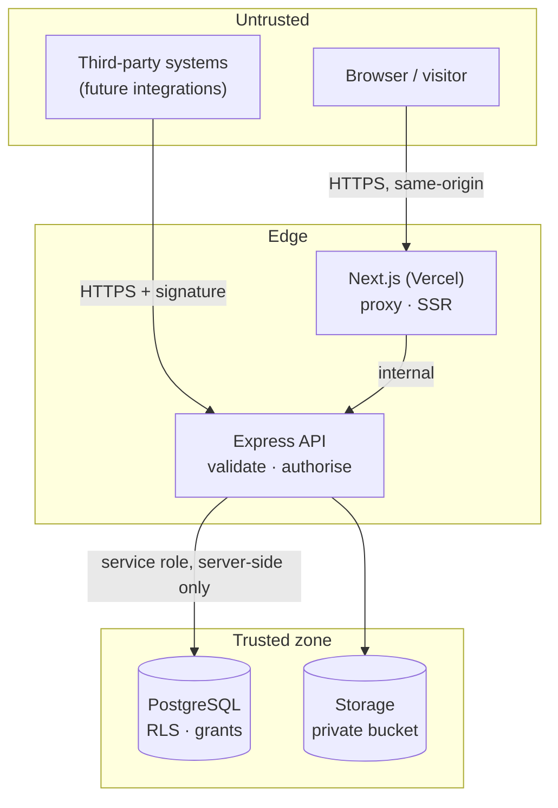

# Security & Tenant-Isolation Plan — SalesTrace Ethiopia

## 1. Trust boundaries



Rules:

- The **service-role / database credentials never reach the browser**. The web app talks only to
  the API.
- The API treats every request body, query parameter, path parameter, header, and uploaded file
  as untrusted until validated.
- The public tracking endpoint (`/r/:code`) is the only unauthenticated write path and it can
  only append click events.

## 2. Tenant isolation

### 2.1 The invariant

> A session belonging to organization A can never read or write a row owned by organization B —
> regardless of the identifier it supplies.

### 2.2 Defence in depth (three independent layers)

| Layer | Mechanism | Failure mode it prevents |
|---|---|---|
| **1. Route/middleware** | The organization is derived from the *session*, never from input. Every `:id` path parameter is re-checked for membership in the session's organization before use. | A request that tries to use another org's UUID |
| **2. Service/repository** | Every SQL statement includes `organization_id = $ctx.organizationId`. Repositories accept the org id as a required argument — it cannot be omitted. | A forgotten `WHERE` clause in application code |
| **3. Database RLS** | `USING (organization_id = app.current_org_id())` on every organization-owned table; the API runs as `salestrace_app` (`NOBYPASSRLS`); the org context is set per transaction via `set_config(..., true)` (transaction-local) | Any path that reaches the database without the org filter |

If the organization context is missing or malformed, `app.current_org_id()` returns `NULL`, the
predicate evaluates to `NULL`, and **zero rows match**. The failure mode is "no data", never "all
data".

### 2.3 Cross-tenant response consistency

A resource belonging to another organization returns `404 NOT_FOUND` — identical to a genuinely
missing resource — so the API never confirms the existence of another tenant's data.

### 2.4 Test obligations

1. A user in org A receives `404` for org B's campaign, creator, order, attribution, import job,
   tracking link, and export.
2. A user in org A cannot mutate org B's data by crafting a request body with B's identifiers.
3. With no organization context set, a direct query returns zero organization-owned rows
   (proves RLS fails closed).
4. `salestrace_app` cannot `UPDATE` or `DELETE` `audit_events`.
5. The tracking endpoint cannot be used to write into another organization (the code resolves
   server-side to exactly one organization).

## 3. Authentication & session management

| Control | Implementation |
|---|---|
| Password storage | Supabase Auth (bcrypt/argon2 managed) in `supabase` mode; **scrypt** (`N=16384, r=8, p=1`, 32-byte salt, 64-byte key) in `local` mode |
| Password policy | ≥ 10 chars, ≥ 1 letter, ≥ 1 digit, checked at registration and reset |
| Session token | Random 32-byte, stored **hashed** (sha256) in `sessions`; httpOnly cookie `st_session` |
| Cookie flags | `HttpOnly`, `SameSite=Lax`, `Secure` (production), `Path=/api`, `Max-Age` 7 days |
| Session fixation | A new token is issued on every login and on password reset; old sessions are revoked on reset |
| Session expiry | 7 days absolute; sliding renewal on activity |
| Email verification | Required before the account can be used in `supabase` mode; a verification token with 24 h expiry in `local` mode |
| Password reset | Single-use, 1-hour token; response is always `202` to prevent user enumeration |
| Brute force | Rate limits on `/auth/*` (10 / 15 min / IP) + per-account lockout counters |
| Logout | Server-side revocation (`sessions.revoked_at`) |

## 4. Authorisation model

Authorisation is checked in the middleware chain by **capability**, not by resource-type
conditionals scattered through handlers.

```ts
const CAPABILITIES = {
  owner:  ['campaign:read','campaign:write','creator:read','creator:write','tracking:read',
           'tracking:write','order:read','order:write','attribution:read','attribution:write',
           'report:read','member:read','member:write','org:read','org:write','audit:read'],
  admin:  ['campaign:read','campaign:write','creator:read','creator:write','tracking:read',
           'tracking:write','order:read','order:write','attribution:read','attribution:write',
           'report:read','member:read','org:read','audit:read'],
  marketer:['campaign:read','campaign:write','creator:read','creator:write','tracking:read',
           'tracking:write','order:read','order:write','attribution:read','attribution:write',
           'report:read','member:read','org:read'],
  analyst:['campaign:read','creator:read','tracking:read','order:read','attribution:read',
           'report:read','member:read','org:read'],
} as const;
```

Route handlers declare the capability they need; the middleware rejects with `403` before the
handler runs. The UI hides affordances for convenience only — the server is the authority.

**Ownership rules:** the last `owner` of an organization cannot be removed or demoted (prevents
locking the tenant out). An `owner` cannot remove themselves if they are the last owner.

## 5. Input validation

| Surface | Rule |
|---|---|
| Request bodies | Zod schema per route; unknown keys stripped, not passed through |
| Query & path params | Zod schemas with coercion and allowlists (`sort`, `status`, `method`) |
| Money | Decimal **strings** parsed into `BIGINT` minor units via a string parser — never `parseFloat` |
| Dates | ISO-8601 parsed into `Date`; stored as UTC `TIMESTAMPTZ` |
| Uploads | Extension + content sniffing, ≤ 10 MB, streamed to disk with a size cap, stored under a generated name (never the user's filename) |
| CSV rows | Per-row validation; invalid rows are recorded, never partially applied |
| URLs | `https` only; redirect targets come from the database, never from a request parameter |

## 6. Injection & query safety

- **SQL injection:** all queries use parameterised statements (`$1`, `$2`, …). Identifiers (sort
  columns) are validated against an allowlist and never interpolated from user input.
- **Command injection:** no shell invocation exists in the codebase; the migration runner uses the
  `pg` client, not `psql`.
- **Prototype pollution / mass assignment:** Zod schemas strip unknown keys; there is no
  "spread the body into the model" pattern.
- **CSV formula injection:** exported CSVs prefix cells beginning with `=`, `+`, `-`, `@` with a
  `'` so spreadsheets do not execute them.

## 7. CSRF

The session cookie is `SameSite=Lax` and the browser only ever talks to one origin (the Next.js
app proxies the API), so cross-site form posts cannot carry the cookie. As a second layer, every
mutating request must present an `Origin` (or `Referer`) header matching the configured allowed
origins; otherwise the request is rejected with `403`.

A request that authenticates with an `Authorization: Bearer` header is exempt from the origin
check: a bearer token is not an ambient credential — the browser cannot attach it to a
cross-site request without a CORS preflight — so CSRF does not apply to it.

### Sessions before organizations

`POST /api/v1/organizations` creates the *first* organization for a user who therefore cannot
yet have an organization in their session. That endpoint resolves the session but does **not**
require an organization context; every other endpoint requires both an authenticated session and
an active organization. The organization is always taken from the session, never from the body.

## 8. CORS

The API allows only explicitly configured origins (`CORS_ALLOWED_ORIGINS`). Credentials are allowed
(cookie sessions) but `origin` is never reflected dynamically. Preflight is handled with a 10 s
max-age. In production the default allowlist contains the web app's own origin only.

## 9. Rate limiting & abuse control

| Endpoint | Limit | Key |
|---|---|---|
| `GET /r/:code` | 120 / min | IP (hashed) |
| `/auth/login`, `/auth/register`, `/auth/forgot-password` | 10 / 15 min | IP + account |
| `POST /orders/imports` | 5 / 10 min | organization |
| All other API routes | 300 / min | user id |

Rate-limit keys are hashed; raw IPs are never persisted.

## 10. Data protection & privacy

| Data | Handling |
|---|---|
| Visitor IP | Never stored raw. `sha256(ip + server pepper)` → `ip_hash`; `sha256(ip + ua)` → `fingerprint` |
| User agent / referrer | Stored truncated (512 / 1024 chars) for diagnostics only |
| Customer references in orders | Stored only as `customer_ref_hash` (sha256). The raw value is used transiently during import and discarded |
| Contact details of creators | Visible only to members of the owning organization; included in exports only for roles with `report:read` |
| Passwords / tokens | Never logged, never returned, stored only as hashes |
| Logs | Structured JSON; request bodies are **not** logged for auth routes; secrets are redacted by key name |
| Secrets | Environment variables only; `.env` is git-ignored; `.env.example` documents every variable with no real values |
| Debug output | Stack traces, SQL, and internal identifiers are never returned to clients — only a `requestId` |

## 11. Audit trail

Recorded events (`audit_events`): organization changes, member add/role change/removal, campaign
create/update/status change/archive, creator create/update/delete, tracking asset
create/deactivate, cost create/delete, order import (created/committed/failed), refund recorded,
attribution recompute, and role/permission changes.

Each event stores the actor, their role at the time, the entity, the before/after state, the
request id, and a hashed IP.

**Append-only at the application level:** `UPDATE` and `DELETE` are revoked from the application
role and a trigger raises an exception on any attempt. This deters and detects ordinary tampering;
it is **not** a claim of tamper-proofing (a database superuser can still alter rows).

## 12. Financial data integrity

- Money is `BIGINT` minor units — no floating point in authoritative paths.
- Unique constraints protect against double counting:
  - `orders (organization_id, external_order_id)` — one row per source order.
  - `attributions (order_id)` — one attribution per order.
- Imports run inside a transaction; a failure rolls back the whole batch.
- `campaign_costs.amount_minor >= 0` and `campaign_costs.currency = campaigns.currency` are
  enforced by checks/validation.
- Refunds are appended, never overwritten; a refund can never exceed the order total.

## 13. Secrets & configuration

- `SUPABASE_SERVICE_ROLE_KEY` is used **only** inside the API process. It is never sent to the
  browser, never logged, and the web app never receives it.
- The API validates its configuration at boot and refuses to start with a missing/invalid value,
  printing the variable name and expected format — never the value.
- `NODE_ENV=production` additionally refuses to start when `AUTH_MODE=local`, when `COOKIE_SECURE`
  is not `true`, or when the database URL is not TLS-protected.

## 14. Reliability & data protection

| Concern | Control |
|---|---|
| Backups | Supabase automated daily backups + point-in-time recovery (production). Restore procedure documented in `docs/implementation-plan.md` §7. |
| Transactions | Multi-table writes (import, attribution) run in one transaction. |
| Graceful shutdown | `SIGTERM` stops accepting connections, drains in-flight requests, closes the pool. |
| Health checks | `GET /api/v1/health` (liveness) and `GET /api/v1/health/ready` (checks the database). |
| Idempotency | `Idempotency-Key` on imports and recomputes; unique constraints as the final backstop. |
| Retention | `docs/database-schema.md` §5. Tracking data is purged by a scheduled job after the configured period. |

## 15. Known residual risks

1. **Supabase `postgres` role bypasses RLS.** Application traffic uses `salestrace_app`
   (`NOBYPASSRLS`), but anyone holding the database owner's credentials can read any tenant's data.
   Mitigated by credential hygiene; monitored via `audit_events`.
2. **Attribution is association, not causation.** Product-level risk, mitigated by the copy rules
   ("attributed", never "incremental"/"caused").
3. **CSV import trusts the customer's export.** A manipulated CSV can inject false revenue. Mitigated
   by reconciliation warnings, audit trail, and the fact that only the organization's own members
   can import.
4. **Local auth mode is not production-grade.** Explicitly blocked in production by a boot check.
5. **No WAF/rate-limit distribution** — the API relies on host-level limits; the deployment guide
   requires provider-level rate limiting as well.
