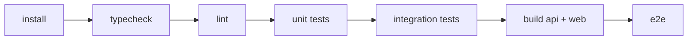

# Testing Strategy — SalesTrace Ethiopia

## 1. Philosophy

| Layer | What it proves | Infrastructure |
|---|---|---|
| **Unit** | The business rules are correct in isolation | none |
| **Integration** | The database, RLS, repositories and HTTP layer behave correctly together | PGlite (in-process Postgres) |
| **E2E** | A real user can complete the critical journey in a browser | Playwright + the running API |

The rule: **a feature is not "done" until the rule it implements has a test that fails when the
rule is broken.** A passing page load is never evidence.

## 2. Unit tests

Location: `packages/attribution-engine/tests`, `apps/api/tests/unit`.

| Area | Cases |
|---|---|
| Attribution window | Click exactly at the boundary (inclusive), 1 ms outside (exclusive), click after the order, click before the campaign start, click after the campaign end, click before the creator was assigned |
| Last-eligible-click | Two creators clicked → later wins; identical timestamps → higher `sequence` wins; ineligible clicks ignored |
| Coupon attribution | Valid coupon with no click; expired coupon; inactive coupon; coupon outside validity; site-wide (non-creator) coupon ignored |
| Conflicts | Click + coupon, different creators → coupon wins, `conflict_flag = true`, losing candidate recorded; click + coupon, same creator → one attribution, no conflict flag |
| Order status handling | `cancelled` → `is_valid_sale = false`; `pending` → not a valid sale; `refunded` → valid sale with net 0 |
| Refunds | Partial refund; full refund; refund larger than the order is capped at the order total |
| Currency mismatch | Order in a different currency is attributed but excluded from revenue |
| Metrics | Conversion rate; ROAS; cost per attributed order; revenue per creator; **zero-denominator → `null`, never `NaN`/`Infinity`** |
| Rounding | Half-up rounding at 2 dp (`454.545… → 454.55`), 1/3 and 2/3 cases, negative-safe |
| Money parsing | `"1,500.00"` → `150000`; `"1500"` → `150000`; `"0.01"` → `1`; invalid input rejected; no float round-trip (`"0.1" + "0.2"` style checks) |
| Duplicate detection | Same `external_order_id` in one file → second row flagged duplicate; re-import of the same file → no new rows |
| Import validation | Missing required column, bad date, negative amount, bad status, unknown currency, mismatched total (warning, not error) |
| Campaign status transitions | Every legal transition passes; every illegal transition is rejected with the right code |
| Tracking code generation | Uniqueness, alphabet (no ambiguous characters), fixed length |

## 3. Integration tests

Location: `apps/api/tests/integration`. Each test file boots PGlite, applies the real migrations,
and inserts fixtures through the repositories.

| Area | Cases |
|---|---|
| Migrations | Every migration applies cleanly on an empty database; re-running the runner is a no-op |
| Repositories | CRUD, pagination, filtering, sorting; `organization_id` scoping on every method |
| **Tenant isolation** | Org A cannot read/update/delete org B's campaign, creator, order, attribution, tracking link, import job, or export — each returns `404` |
| **RLS fails closed** | A query with no `app.current_org_id` set returns zero organization-owned rows |
| **Audit append-only** | `UPDATE`/`DELETE` on `audit_events` raises for the application role |
| Auth | Register → verify → login → session cookie → `/auth/me`; wrong password, unverified email, expired token, revoked session |
| Authorisation | Each role's allowed/forbidden capability matrix (table-driven) |
| Campaign lifecycle | Create → activate → pause → resume → complete → archive; illegal transitions rejected |
| Creator assignment | Assign, update fee, back-date `assigned_at`, remove; duplicate assignment rejected |
| Tracking | Link creation generates a unique code; `/r/:code` records a click and 302s to the stored destination; unknown code 404s; inactive link 404s; a `url` query parameter cannot change the destination (open-redirect test) |
| Click de-duplication | Two hits within 30 s increment `repeat_count` rather than creating a second event |
| CSV import | Header mapping, validation, preview counts, commit, error report contents, **re-import produces no duplicates**, import of a file containing a duplicate id inside itself |
| Attribution persistence | Import → attribution rows created; one row per order; re-compute is idempotent; conflict recorded with the losing candidate |
| Refunds | A refund import appends a refund row and reduces net revenue; a second import of the same refund does not double-count |
| Analytics totals | Dashboard totals equal the sum of the underlying attributed rows; the reconciliation identities in `docs/financial-metrics.md` §7 hold |
| Exports | CSV export honours the same filters and the same org scope as the on-screen report |
| Idempotency | The same `Idempotency-Key` replays the stored response; a different body with the same key → `409` |
| Rate limits | The public tracking endpoint returns `429` past the configured limit |

## 4. End-to-end tests

Location: `apps/web/e2e`. Playwright drives a real browser against the running API + web app.

**Journey 1 — the critical path** (the master brief's 10 steps):

1. Register a user and create an organization.
2. Create a campaign.
3. Assign two creators.
4. Generate tracking links and coupon codes.
5. Open a tracking link → a referral event is recorded.
6. Import an order CSV.
7. Verify the orders are attributed per the configured rules.
8. Verify the dashboard shows the correct metrics.
9. Export the campaign report and check the contents.
10. Sign in as a user from another organization and confirm every resource returns `404`.

**Journey 2 — refunds and cancellations:** import orders, then re-import with a refund and a
cancellation; verify net revenue, cancelled counts, and the valid-order count all move correctly.

**Journey 3 — conflicts:** import an order whose coupon belongs to a different creator than the
clicked link; verify the coupon wins, the conflict is flagged, and the conflict count appears in
the dashboard.

**Journey 4 — authorisation:** an `analyst` sees read-only UI and receives `403` on writes.

Deterministic fixtures only. No test depends on wall-clock time or random seeds that are not
controlled (timestamps are injected through the clock abstraction).

## 5. Test data & isolation

- Seed data lives in `supabase/seed.sql` and is explicitly labelled **demo data**; the web UI
  marks demo records.
- Integration tests use dedicated PGlite instances per test file — no shared state, no ordering
  dependencies.
- E2E runs against a dedicated database and seeds only what each test needs.

## 6. CI pipeline

Every stage must pass. Coverage is reported for `packages/attribution-engine` and the API's
`src/modules` + `src/shared` directories; the target is ≥ 80 % lines on the business-logic folders
with 100 % coverage of the attribution engine's rule branches.

## 7. Definition of test done

- Every business rule in `docs/attribution-rules.md` and `docs/financial-metrics.md` maps to at
  least one named test.
- Cross-tenant access is attempted in both directions and asserted `404`.
- The dashboard reconciliation identities are asserted against the database, not against another
  API response (so a shared bug in the calculation layer cannot hide).
- Financial tests assert exact minor-unit values, not approximations.

## 8. Current status

| Suite | Files | Tests | Result |
|---|---|---|---|
| `packages/attribution-engine/tests` | 2 | 38 | passing |
| `apps/api/tests/unit` | 3 | 31 | passing |
| `apps/api/tests/integration` | 5 | 92 | passing |
| `apps/web/src/**/__tests__` | 2 | 16 | passing |
| **Total** | **12** | **177** | **passing** |

The Playwright specs in `apps/web/e2e` are written and type-check, but they need a running
stack (database + API + web app); they are executed by the `e2e` job in the CI pipeline, which
starts a real PostgreSQL service.

> **Environment note.** On a machine without a pagefile, Node cannot allocate a heap and fails
> with `Zone Allocation failed - process out of memory`. Every command in this repository then
> needs a constrained heap, e.g.
> `NODE_OPTIONS="--max-old-space-size=300 --max-semi-space-size=2" pnpm test`. CI does not
> require the constraint.
